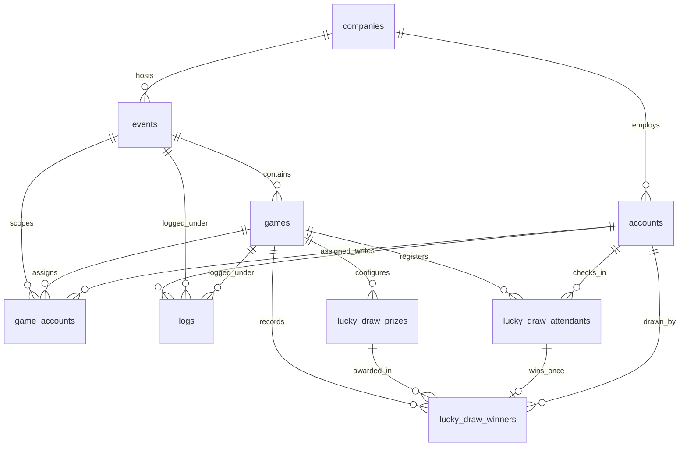
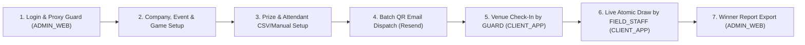

# Project Context Prompt

> [!NOTE]
> Feed this architectural context prompt (paired with the **Master Convention Prompt**) to AI agents at the start of new sessions so they immediately understand the full domain, tech stack, database schema, RBAC security model, and operational flows.

---

## 1. Domain & Ecosystem Overview

**Event Tools** is a **Multi-Tenant Event & Interactive Game Ecosystem** built for corporate clients (`[MANAGER]`) to configure events, manage guest lists, dispatch QR-coded email invitations, check in attendees on-site, and run live interactive big-screen venue games (starting with **Lucky Draw**, architected as a modular game-plugin system for future games such as Quiz, Bingo, or Voting).

The workspace comprises three sub-systems:

1. **`[ADMIN_WEB]` (`admin-web/`) — Cloud CMS & Tenant Portal (Active Repo)**
   - Used by system developers (`SUPER_ADMIN`) and corporate client managers (`ADMIN`) to configure companies, accounts, events, games, prizes, attendant imports, batch QR email dispatches, audit logs, and post-event Excel winner reports.
2. **`[DATABASE_BENCHMARK]` (`database-benchmark/`) — Schema Migrations, Seeds & Query Profiler (Active Repo)**
   - Houses the authoritative PostgreSQL/Supabase `.sql` schema migrations (`0_wipe-data.sql` through `10_log.sql`), Faker-based CSV seed generators, and latency benchmark suite (`benchmark-db.ts`).
3. **`[CLIENT_APP]` (Planned Desktop Repo — Electron + React/TypeScript)**
   - On-site venue application used strictly by `GUARD` (QR/manual guest check-in) and `FIELD_STAFF` (full-screen live game presentation and atomic winner draws).

---

## 2. Tech Stack (`[ADMIN_WEB]` & Backend)

| Layer                   | Technology                                                         | Implementation Details                                                                                                                         |
| :---------------------- | :----------------------------------------------------------------- | :--------------------------------------------------------------------------------------------------------------------------------------------- |
| **Framework**           | Next.js `16.4` (App Router, Turbopack) + React `19.3`              | Uses Server Components (RSC), Server Actions (`'use server'`), Client Components (`'use client'`), and Next.js 16 `src/proxy.ts` request guard |
| **Language**            | TypeScript `5` (`strict: true`)                                    | Global ambient namespace `AdminWeb` (`src/types/index.d.ts`) + generated Supabase types (`src/types/supabase.ts`)                              |
| **Styling**             | Tailwind CSS `4.3` + `tailwind-variants` `3.3` + CSS Modules       | CSS-first `@theme` tokens in `src/styles/theme.css`; zero inline Tailwind in JSX (`use-style.ts` pattern)                                      |
| **Database & Auth**     | Supabase (`@supabase/ssr`, `@supabase/supabase-js` `2.117`)        | PostgreSQL with Row-Level Security (RLS), `pg_trgm` + `btree_gin` extensions, and JWT `app_metadata` sync triggers                             |
| **Forms & Validation**  | `react-hook-form` `7.91` + `zod` `4.6` + `@hookform/resolvers` `6` | Schema-driven validation (`mode: 'onChange'`) paired with React 19 `useTransition`                                                             |
| **Localization**        | `i18next` `26.5` + `react-i18next` `17.1`                          | Vietnamese (`vi`) primary locale via scoped `useTranslate({ prefix })`                                                                         |
| **UI Feedback & Icons** | `sonner` `2.0` + `lucide-react` `1.61`                             | Bottom-right rich-color toast notifications and vector iconography                                                                             |
| **Email Dispatch**      | `resend` `6.34`                                                    | Transactional batch invitation & QR code email delivery                                                                                        |

---

## 3. Stakeholders, Roles & RBAC Model

Every authenticated user maps `1:1` between `auth.users` and `public.accounts`. A PostgreSQL trigger (`sync_account_metadata_to_auth`) automatically mirrors `accounts.role` and `accounts.company_id` into `auth.users.raw_app_meta_data` so server/browser sessions read `user.app_metadata.role` and `user.app_metadata.company_id` without extra round-trips.

| Role (`account_role`) | Stakeholder              | Allowed App(s)                | Routing & Tenant Scope                                                                                                                                                                                                                      |
| :-------------------- | :----------------------- | :---------------------------- | :------------------------------------------------------------------------------------------------------------------------------------------------------------------------------------------------------------------------------------------ |
| **`SUPER_ADMIN`**     | Platform Devs (`[DEV]`)  | `[ADMIN_WEB]`, `[CLIENT_APP]` | Global access across all tenants (`/super-admin` & `/admin/[companyId]`). Sole role permitted to provision `ADMIN` accounts and access `games.is_dev_only = true` beta features.                                                            |
| **`ADMIN`**           | Client Org (`[MANAGER]`) | `[ADMIN_WEB]` ONLY            | Strictly isolated to their single `company_id` (forced by `src/proxy.ts` to `/admin/[companyId]`). Manages own company profile, events, games, prizes, attendants, and `FIELD_STAFF`/`GUARD` sub-accounts. Hidden from `is_dev_only` games. |
| **`FIELD_STAFF`**     | Venue Game Operator      | `[CLIENT_APP]` ONLY           | Blocked from logging into `[ADMIN_WEB]`. Can only read/operate events and games explicitly linked to their `account_id` in `public.game_accounts`.                                                                                          |
| **`GUARD`**           | Venue Security           | `[CLIENT_APP]` ONLY           | Blocked from logging into `[ADMIN_WEB]`. Accesses Check-In Tool (QR scan or manual lookup) only for games/events assigned in `public.game_accounts`.                                                                                        |
| **`NOT_ASSIGNED`**    | Unprovisioned Auth User  | None                          | Default `account_role` prior to role assignment; denied CMS/venue access.                                                                                                                                                                   |

_(Note: Event attendees `[CUSTOMER]` do NOT have `accounts` rows; they exist as game-scoped records such as `lucky_draw_attendants`.)_

---

## 4. Authoritative Database Schema (PostgreSQL / Supabase)

### 4.1 Entity-Relationship Diagram

### 4.2 Core Ecosystem Tables

1. **`public.companies`** — Tenant organizations
   - **Columns:** `id` (UUID PK), `name` (NOT NULL), `tax_code`, `industry`, `contact_person`, `contact_email`, `contact_phone`, `address`, `logo_url`, `status` (`company_status`: `'ACTIVE' | 'INACTIVE' | 'SUSPENDED'`, default `'ACTIVE'`), `created_at`, `updated_at`, `search_text` (generated from `name`, `tax_code`, `contact_person`, `contact_email`, `contact_phone`).
   - **RLS:** `SUPER_ADMIN` (`ALL`); `ADMIN` (`ALL` where `id = get_caller_company_id()`).

2. **`public.accounts`** — Platform & venue staff credentials (synced with `auth.users`)
   - **Columns:** `id` (UUID PK), `email` (UNIQUE NOT NULL), `username` (UNIQUE), `password_hash`, `full_name`, `phone`, `role` (`account_role`, default `'NOT_ASSIGNED'`), `company_id` (UUID FK -> `companies.id` `ON DELETE CASCADE`, nullable for `SUPER_ADMIN`), `is_active` (BOOLEAN default `true`), `created_at`, `updated_at`, `search_text` (generated from `full_name`, `email`, `username`, `phone`).
   - **Auth Sync Triggers:** `on_auth_user_created` -> `handle_new_user()`; `on_auth_user_updated` -> `handle_user_updated()`; `on_account_metadata_changed` -> `sync_account_metadata_to_auth()`.
   - **RLS:** Self (`SELECT`/`UPDATE` where `auth.uid() = id`); `SUPER_ADMIN` (`ALL`); `ADMIN` (`ALL` where `company_id = get_caller_company_id()`).

3. **`public.events`** — Physical or hybrid corporate events (`1 Company : N Events`)
   - **Columns:** `id` (UUID PK), `company_id` (UUID FK -> `companies.id` `ON DELETE CASCADE`), `name` (NOT NULL), `slug` (UNIQUE NOT NULL), `description`, `location_name`, `location_address`, `start_time` (TIMESTAMPTZ NOT NULL), `end_time` (TIMESTAMPTZ NOT NULL), `banner_url`, `theme_config` (JSONB default `'{}'`), `status` (`event_status`: `'DRAFT' | 'UPCOMING' | 'ONGOING' | 'COMPLETED' | 'CANCELLED'`), `created_at`, `updated_at`, `search_text` (generated from `name`, `slug`, `location_name`, `location_address`).
   - **RLS:** `SUPER_ADMIN` (`ALL`); `ADMIN` (`ALL` where `company_id = get_caller_company_id()`); `FIELD_STAFF`/`GUARD` (`SELECT` where `id IN (SELECT event_id FROM game_accounts WHERE account_id = auth.uid())`).

4. **`public.games`** — Modular game instances inside an event (`1 Event : N Games`)
   - **Columns:** `id` (UUID PK), `event_id` (UUID FK -> `events.id` `ON DELETE CASCADE`), `name` (NOT NULL), `description`, `game_type` (`game_type`: `'LUCKY_DRAW'`), `config` (JSONB default `'{}'`), `is_dev_only` (BOOLEAN default `false`), `status` (`game_status`: `'PENDING' | 'READY' | 'LIVE' | 'FINISHED'`), `created_at`, `updated_at`, `search_text` (generated from `name`, `description`).
   - **RLS:** `SUPER_ADMIN` (`ALL`); `ADMIN` (`ALL` where `get_event_company_id(event_id) = get_caller_company_id()`); `FIELD_STAFF`/`GUARD` (`SELECT` where `id IN (SELECT game_id FROM game_accounts WHERE account_id = auth.uid())`).

5. **`public.game_accounts`** — Many-to-many staff assignment junction
   - **Columns:** `id` (UUID PK), `game_id` (UUID FK -> `games.id`), `event_id` (UUID FK -> `events.id`), `account_id` (UUID FK -> `accounts.id`), `assigned_at`, `created_at`, `updated_at`.
   - **RLS:** `SUPER_ADMIN` (`ALL`); `ADMIN` (`ALL` for own company events); `FIELD_STAFF`/`GUARD` (`SELECT` where `account_id = auth.uid()`).

6. **`public.logs`** — Immutable append-only audit trail
   - **Columns:** `id` (UUID PK), `account_id` (UUID FK -> `accounts.id`), `event_id` (UUID FK -> `events.id`, nullable), `game_id` (UUID FK -> `games.id`, nullable), `action_type` (`log_action_type`, e.g., `'EMAIL_BATCH_SEND'`, `'CHECKIN_QR_SCAN'`, `'CHECKIN_MANUAL_SEARCH'`, `'PRIZE_DRAWN'`), `target_entity` (TEXT), `target_id` (TEXT), `metadata` (JSONB default `'{}'`), `created_at`, `search_text` (generated from `target_entity`, `target_id`).
   - **RLS:** Read-only (`SELECT`) for `SUPER_ADMIN` and company-scoped `ADMIN`; `INSERT` only where `account_id = auth.uid()`; NO `UPDATE` or `DELETE` policies.

### 4.3 Game Module #1 Tables (`lucky_draw_*`)

7. **`public.lucky_draw_prizes`**
   - **Columns:** `id` (UUID PK), `game_id` (UUID FK -> `games.id` `ON DELETE CASCADE`), `name` (NOT NULL), `description`, `image_url`, `tier_order` (INT NOT NULL), `total_quantity` (INT NOT NULL `CHECK (total_quantity >= 1)`), `remaining_quantity` (INT NOT NULL `CHECK (remaining_quantity >= 0 AND remaining_quantity <= total_quantity)`), `created_at`, `updated_at`, `search_text` (generated from `name`, `description`).
   - **RLS:** `SUPER_ADMIN` (`ALL`); `ADMIN` (`ALL` for own company's games); Assigned Staff (`SELECT`).

8. **`public.lucky_draw_attendants`**
   - **Columns:** `id` (UUID PK), `game_id` (UUID FK -> `games.id` `ON DELETE CASCADE`), `full_name` (NOT NULL), `email`, `phone`, `ticket_code` (NOT NULL, `UNIQUE (game_id, ticket_code)`), `company_name`, `department`, `custom_metadata` (JSONB default `'{}'`), `qr_code_payload` (TEXT UNIQUE NOT NULL), `email_status` (`email_status_type`: `'NOT_SENT' | 'SENDING' | 'SENT' | 'FAILED'`), `email_sent_at`, `is_checked_in` (BOOLEAN default `false`), `checked_in_at`, `checked_in_by` (UUID FK -> `accounts.id` `ON DELETE SET NULL`), `check_in_method` (`check_in_method_type`: `'QR_SCAN' | 'MANUAL_SEARCH'`), `has_won` (BOOLEAN default `false`), `created_at`, `updated_at`, `search_text` (generated from `full_name`, `email`, `phone`, `ticket_code`, `company_name`).
   - **Indexes:** Composite `btree_gin` index `USING GIN (game_id, search_text gin_trgm_ops)` + live-draw index `(game_id, is_checked_in, has_won)`.
   - **RLS:** `SUPER_ADMIN` (`ALL`); `ADMIN` (`ALL` for own company's games); Assigned Staff (`SELECT`, `UPDATE`).

9. **`public.lucky_draw_winners`** — Immutable winner ledger
   - **Columns:** `id` (UUID PK), `game_id` (UUID FK -> `games.id`), `prize_id` (UUID FK -> `lucky_draw_prizes.id`), `attendant_id` (UUID FK -> `lucky_draw_attendants.id`), `drawn_by` (UUID FK -> `accounts.id` `ON DELETE SET NULL`), `won_at` (TIMESTAMPTZ default `now()`), constraint `UNIQUE (game_id, attendant_id)`.
   - **RLS:** `SUPER_ADMIN` (`ALL`); `ADMIN` (`SELECT` only — read-only for reporting/export); Assigned Staff (`SELECT`, `INSERT`).

### 4.4 Core SQL Security & Performance Primitives

- **RLS Helper Functions (`SECURITY DEFINER STABLE`):** `public.get_caller_role()`, `public.get_caller_company_id()`, `public.get_event_company_id(target_event_id)`, `public.get_log_account_company_id(target_account_id)`.
- **Search Architecture:** Sub-millisecond partial text matching across dashboard datatables relies on `search_text` stored generated columns + `pg_trgm` GIN indexes (`query.ilike('search_text', '%term%')`).

---

## 5. Core Operational Flows

1. **Authentication & Request Proxy (`[ADMIN_WEB]`):**
   - Users sign in via `PageAuthorizeLogin` -> `useServiceAccountLogin`, which authenticates against Supabase Auth, verifies `accounts.is_active === true`, and rejects any role other than `SUPER_ADMIN` or `ADMIN` (signing out unauthorized roles immediately).
   - On every navigation, `src/proxy.ts` inspects the server session via `useServicesUserRead`:
      - Unauthenticated users outside `/login` or `/forget-password` redirect to `/login`.
      - `SUPER_ADMIN` outside allowed routes redirects to `/super-admin`.
      - `ADMIN` outside `/admin/*` redirects to `/admin/[companyId]`.
2. **Tenant Dashboard & Game Selection (`[ADMIN_WEB]`):**
   - `PageAdminHome` (`/admin/[companyId]`) renders `CompanyInfoCard` (with modal `CompanyEditForm` for inline tenant profile updates) and `EventGameOverview`.
   - `EventGameSelector` cascades `Company -> Event -> Game`. Selecting a `LUCKY_DRAW` game mounts `GameLuckyDrawOverview` (live prize/staff counters + manual sync refresh + `AttendantsDatatable` with debounced search, check-in/winner filtering, and pagination).
3. **Prize, Attendant & QR Email Preparation (`[ADMIN_WEB]`):**
   - `ADMIN` configures prize tiers (`total_quantity >= 1`), imports/creates attendants (each receiving a unique `qr_code_payload` and per-game unique `ticket_code`), and triggers batch Resend emails embedding each guest's QR code (`email_status` tracked per attendant + `EMAIL_BATCH_SEND` audit log).
4. **Venue Check-In (`[CLIENT_APP]` — `GUARD`):**
   - **Path A (QR Scan):** Validates `qr_code_payload`, sets `is_checked_in = true`, `checked_in_at = now()`, `checked_in_by = auth.uid()`, `check_in_method = 'QR_SCAN'`, and logs `CHECKIN_QR_SCAN`.
   - **Path B (Manual Lookup):** Searches attendant by name/phone/email/ticket, confirms identity, marks `is_checked_in = true`, `check_in_method = 'MANUAL_SEARCH'`, and logs `CHECKIN_MANUAL_SEARCH` (storing the search query inside `logs.metadata`).
5. **Live Lucky Draw Execution (`[CLIENT_APP]` — `FIELD_STAFF`):**
   - Queries prizes with `remaining_quantity > 0` and eligible attendants (`is_checked_in == true` AND `has_won == false`).
   - Selecting a winner MUST execute a single **atomic PostgreSQL transaction (RPC)**:
      1. Insert winner row into `lucky_draw_winners`.
      2. Atomically decrement `lucky_draw_prizes.remaining_quantity = remaining_quantity - 1` (guarded by `remaining_quantity > 0`).
      3. Update `lucky_draw_attendants.has_won = true`.
      4. Insert `PRIZE_DRAWN` into `logs`.
6. **Post-Event Reporting (`[ADMIN_WEB]`):**
   - `ADMIN` views read-only winner results (joining `lucky_draw_winners`, `lucky_draw_prizes`, and `lucky_draw_attendants`) and exports formatted `.xlsx` reports.

---

## 6. Critical Business Invariants & Architectural Gotchas

> [!WARNING]
> Violating any of the invariants below introduces cross-tenant security leaks or live-venue data corruption.

1. **Zero Cross-Tenant Leakage:** Every `ADMIN` read/write MUST enforce `company_id` ownership at BOTH the service layer (`useServicesUserRead`) and PostgreSQL RLS layer. Never trust URL `companyId` or client payloads without verifying against `user.app_metadata.company_id`.
2. **Check-In Prerequisite for Winning:** An attendant with `is_checked_in = false` or `has_won = true` MUST NEVER enter the draw pool or be inserted into `lucky_draw_winners`.
3. **Atomic Stock Decrements Only:** Never compute `remaining_quantity - 1` in client JavaScript; concurrent draws must rely on atomic database transactions enforcing `remaining_quantity >= 0`.
4. **Dev-Only Feature Gating:** Games with `is_dev_only = true` are strictly invisible and inaccessible to `ADMIN`, `FIELD_STAFF`, and `GUARD` roles — only `SUPER_ADMIN` can view or configure them.
5. **Immutable Audit & Winner Ledgers:** `public.logs` and `public.lucky_draw_winners` are append-only ledgers for `ADMIN` and venue staff; never build UI or services allowing `ADMIN` to mutate or delete historical audit logs or drawn winners.
6. **Modular Game Namespacing:** Isolate all Lucky Draw logic under `features/game-lucky-draw/*`, `services/game-lucky-draw/*`, and `lucky_draw_*` DB tables so future game types (`game_type` enum extensions) plug into `EventGameOverview` without modifying core `company`, `event`, or `account` modules.
7. **Known Schema-to-Typegen Sync Note:** Ensure `admin-web/src/types/supabase.ts` stays regenerated against `database-benchmark/src/migrations/` whenever SQL changes occur (e.g., `search_text` generated columns, `NOT_ASSIGNED` in `account_role`, and `get_caller_role()` / `get_caller_company_id()` functions).
